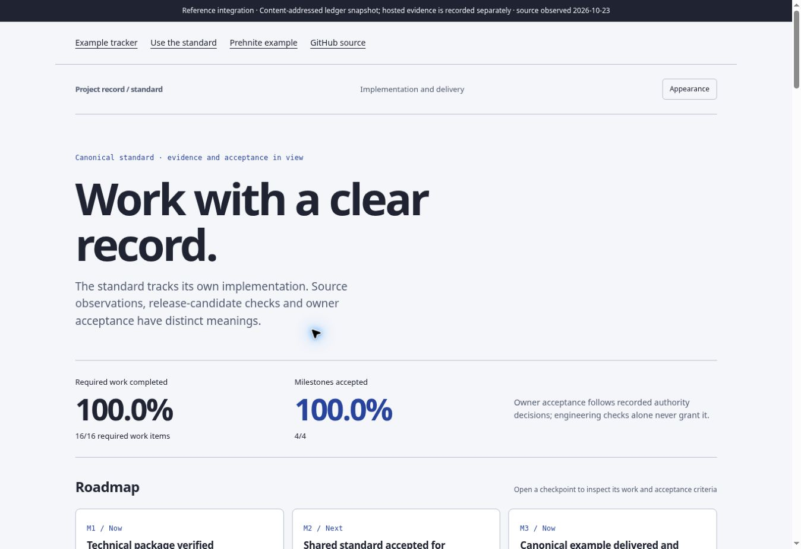
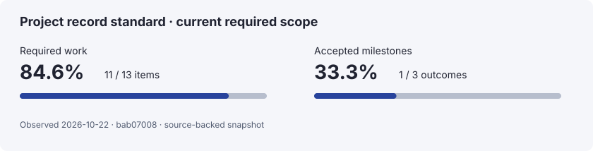

# Project record standard

Give your AI agent a shared way to plan a project, track its progress and explain what comes next. Your project keeps its own website, colours and typography.

The agent inspects what already exists, asks you about the decisions it cannot infer, and fits the tracking system to your project. The result connects an overview, scoped work, milestones, a roadmap, GitHub issues, progress percentages and delivery history.

[Explore the interactive example](https://interzettel.github.io/project-record-standard/) · [Read the guide](standards/START-HERE.md)

[](https://interzettel.github.io/project-record-standard/)

*The standard’s own tracker, captured on 23 October 2026 before the readiness setup extension. The live tracker and progress figures below use the current scope. Your project keeps its own design.*

## Start with your agent

Open your project in an agent that can read and edit its repository. Give it this request:

```text
Set up Project Record Standard in this project:
https://github.com/interzettel/project-record-standard

Read the repository instructions and the toolkit’s
skills/use-project-records/SKILL.md. Use a reviewed toolkit checkout
and record its commit. Preview and apply the included skill installer
for this project, preserving existing agent instructions.

Then start the setup conversation. Inspect the project before asking
me questions: read the docs, existing trackers, GitHub issues, open PRs,
branches, releases and website where accessible. Tell me what you found
and what you could not inspect.

Use establish-project-tracking if there is no established tracker,
or adapt-project-tracking if tracking already exists.
Ask a few focused questions at a time about the intended outcome,
scope, priorities, acceptance and any unresolved source conflicts.
Use what the repository already answers.

Assess L0–L5 agent readiness using the installed router’s readiness
contract. Keep the current evidenced level separate from the target
and from completion percentages. Ask what work I want to delegate;
record R0–R4 task-risk limits and the central assessment reference.
Turn selected readiness gaps into bounded work, without granting
additional merge/deploy authority.

Prepare the project overview and scoped plan. Divide selected work
into work packages and tasks, define milestone exit criteria, and
build a roadmap from priorities and dependencies. Preserve existing
IDs, evidence and history. Keep unselected ideas outside required scope.

Generate the README progress view and prepare an interactive tracker
that fits this project’s own brand and website. Check the counts and
accessibility. Explain what is ready, what remains unknown and the
next action. Prepare GitHub and publishing integrations for review
within the permissions I have given you.
```

The agent needs repository access to do the work. If your runner does not discover `.agents/skills/`, point it to that directory or use its supported skill location. The installer adds guidance; the request above starts the conversation.

### What the agent will ask

Expect questions such as “What should the next deliverable achieve?”, “What is outside this scope?” and “What evidence makes a task Done?” For an existing project, it may also ask which tracker is authoritative or which unfinished PR belongs to the current outcome.

A new project starts with its purpose and boundaries. An existing project starts with its current records and unfinished work. In both cases, the agent uses the answers to prepare a plan you can inspect, then builds the tracking views from that plan.

### Install the skills yourself

Python 3.10 or newer is required. From a reviewed checkout of this toolkit, preview installation, then apply it:

```sh
PYTHONPATH=src python3 -m project_record install-skills --toolkit . --target /path/to/your-project
PYTHONPATH=src python3 -m project_record install-skills --toolkit . --target /path/to/your-project --apply
```

This installs all 11 skills, adds a marked section to `AGENTS.md` and records an installation receipt. It preserves existing instructions and refuses conflicting files. Then give your agent the setup request above. Installation does not itself create a plan, run an AI, change GitHub or deploy a website.

## Readiness is part of setup

The agent also assesses how reliably it can work in the repository: **L1 Reproducible → L2 Legible → L3 Verifiable → L4 Constrained → L5 Measured**. L0 means L1 has not been demonstrated. It checks evidence, asks about the target and delegation boundaries, and plans selected improvements. A 100% work tracker does not imply L5 readiness. See [the readiness guide](standards/READINESS.md).

## What your project gets

- An overview that explains the purpose, scope, owner and acceptance criteria.
- A work breakdown with distinct tasks, dependencies, priorities and milestone gates.
- Exact fractions and percentages in the README and interactive website.
- Progress history that explains both completed work and changes to scope.
- Shared issue titles and labels, with mappings to GitHub milestones and Projects.
- Changelog entries, release-readiness checks and separately recorded deployments.
- Agent guidance for updates, status questions, scope changes, operations and accessibility.

The JSON records supply the shared structure. The presentation uses your project’s fonts, colours and layout. Existing websites can consume the data through `presentation.renderer: host`; the reference page is an optional starting point.

When the project grows, the agent preserves the previous observation, selects the new work and explains how the denominator changed. For example, completing 8 of 10 tasks is 80%; adding 5 required tasks makes that 8 of 15, or 53.3%. The history makes that scope change visible.

## Keep it useful after setup

Ask your agent to “update progress from the work we verified”, “explain what blocks the next milestone”, or “prepare the next release”. The installed router selects the relevant workflow from the [11-skill suite](standards/AGENT-WORKFLOWS.md).

Progress reflects the recorded evidence. A successful build, an owner’s acceptance, a published release and a healthy deployment are separate facts. Missing observations stay visible.

## Try the example locally

The tracking runtime has no third-party dependencies. From the toolkit root:

```sh
PYTHONPATH=src python3 -m project_record check --config examples/projects.json
PYTHONPATH=src python3 -m project_record pipeline --config examples/projects.json --output .record-build --audience public
```

Use a new or empty output directory. Open `.record-build/standard/progress.html` for the standalone tracker. The [automation guide](standards/AUTOMATION.md) covers CI and integration.

<details>
<summary>Build the guide website and run the checks</summary>

```sh
python3 -m pip install --require-hashes -r requirements-site.txt
npm ci --ignore-scripts --no-audit --no-fund
PYTHONPATH=src python3 -m unittest discover -s tests -v
npm test
PYTHONPATH=src python3 tools/check_skills.py
python3 tools/check_palette.py
PYTHONPATH=src python3 tools/build_site.py --records .record-build --output .site
PYTHONPATH=src python3 tools/check_readme.py --records .record-build
```

Serve `.site/` as a static website. Markdown is a documentation build dependency; the locked Node packages are test dependencies.

</details>

## Guides and evidence

[Terminology and percentages](standards/STANDARD.md) · [GitHub integration](standards/GITHUB.md) · [New and existing projects](standards/ADAPTATION-PROFILES.md) · [Agent workflows](standards/AGENT-WORKFLOWS.md) · [Upgrades](standards/UPGRADING.md)

[PMI alignment](standards/PMI-ALIGNMENT.md) describes the tailored use of public project-management guidance. [Accessibility evidence](standards/ACCESSIBILITY.md) records the scoped WCAG 2.2 review and untested screen-reader speech/native zoom. [Delivery evidence](standards/DELIVERY.md) links observed hosted runs and deployments.

The Prehnite reference uses a pinned public source and retains its own brand. Individual repository migrations are separate work.

## This standard’s progress

<!-- project-record:start -->
[](https://interzettel.github.io/project-record-standard/)

| Measure | Completion | Meaning |
| --- | ---: | --- |
| Required work | 17/18 · 94.4% | Completed leaf items in the named required scope. |
| Accepted milestones | 3/4 · 75.0% | Milestones whose declared outcome gates passed. |

[Interactive roadmap](https://interzettel.github.io/project-record-standard/) · Source file: `examples/sources/standard/ledger.json` (content-addressed file snapshot).

Observed 2026-10-23 against `182b6a89`.
<!-- project-record:end -->
