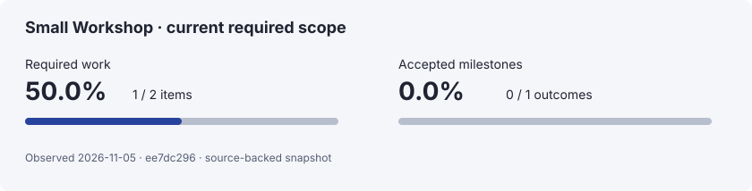

# Small Workshop — authored ✓

No separate site is planned.

<!-- project-record:start -->

| Measure | Completion | Meaning |
| --- | ---: | --- |
| Required work | 1/2 · 50.0% | Completed leaf items in the named required scope. |
| Accepted milestones | 0/1 · 0.0% | Milestones whose declared outcome gates passed. |

Source file: ledger.json (content-addressed file snapshot).

Observed 2026-11-05 against `ee7dc296`.

Retained ledger: 1/3 · 33.3% (includes deferred work).
Source SHA-256: `ee7dc2968c57574cfbba7b366f02f67272f12d347bac2b47d14648140c7fed5b`.
Recorded publication receipts: 0. Work completion does not establish publication or downstream installation.

Milestones and granular work

### Milestones

| Milestone | Required work | Acceptance | Next action |
| --- | --- | --- | --- |
| M — Synthetic outcome | 1/2 · 50.0% | Pending | Verify DOC-2, then the owner separately reviews the outcome. |

### DOC-1 — Publish the local guide

| Field | Source observation |
| --- | --- |
| Priority / state | P1 / Done |
| Scope | Required |
| Criterion | Synthetic implementation and matching check exist. |
| Owner | Synthetic fixture author |
| Dependencies | None recorded |
| Verification / evidence | [test / passed](./evidence/check.txt) · revision aaaaaaaaaaaaaaaaaaaaaaaaaaaaaaaaaaaaaaaa |

### DOC-2 — Check the next criterion

| Field | Source observation |
| --- | --- |
| Priority / state | P2 / Ready · Blocked |
| Scope | Required |
| Criterion | Synthetic implementation and matching check exist. |
| Owner | Synthetic fixture author |
| Dependencies | DOC-1 |
| Verification / evidence | Not recorded |

### DOC-3 — Consider optional polish

| Field | Source observation |
| --- | --- |
| Priority / state | P3 / Backlog |
| Scope | Deferred: Optional fixture idea, outside required scope. |
| Criterion | Synthetic implementation and matching check exist. |
| Owner | Synthetic fixture author |
| Dependencies | None recorded |
| Verification / evidence | Not recorded |

<!-- project-record:end -->

## Maintainer notes
Keep this spacing and café text.
